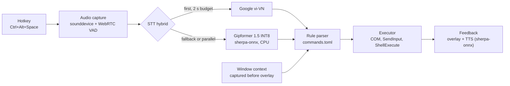

# VoicePilot

A Vietnamese voice assistant for Windows. Press a hotkey, say a command in Vietnamese, and it controls PowerPoint, Edge or Chrome, opens applications, takes screenshots, or dictates text at the cursor.

VoicePilot runs on an ordinary laptop with no GPU. Speech recognition runs in two paths: Google's Vietnamese recognizer and an offline model (Gipformer 1.5, INT8, on CPU). Commands are matched with rules, not a language model, so each recognized utterance either maps to one known function or asks the user to try again.

> **Status:** pre-release (v0.1.0). Open items before release are listed in [`docs/TODO.md`](docs/TODO.md). Unit tests use fake backends and need no microphone, network or Office. Paths that need real hardware (microphone, PowerPoint COM, foreground-window focus, Edge/Chrome keystrokes) are checked manually on Windows; see [`docs/DEMO.vi.md`](docs/DEMO.vi.md). No benchmark numbers are published yet; the measurement procedure is in [`docs/BENCHMARKS.md`](docs/BENCHMARKS.md).

## Features

VoicePilot v1 supports 15 functions. Speak the phrases in Vietnamese; the full phrase list is in [`docs/COMMANDS.vi.md`](docs/COMMANDS.vi.md).

| Group | Function | Example phrase |
|---|---|---|
| PowerPoint | Save | "lưu lại" |
| PowerPoint | Save as | "lưu thành báo cáo tháng chín" |
| PowerPoint | Next slide | "slide tiếp theo" |
| PowerPoint | Previous slide | "slide trước" |
| PowerPoint | Start slide show | "bắt đầu trình chiếu" |
| PowerPoint | Stop slide show | "dừng trình chiếu" |
| Browser (Edge/Chrome) | Open website | "mở youtube" |
| Browser (Edge/Chrome) | Search Google | "tìm thời tiết hôm nay" |
| Browser (Edge/Chrome) | Next tab | "tab tiếp theo" |
| Browser (Edge/Chrome) | Previous tab | "tab trước" |
| Browser (Edge/Chrome) | New tab | "tab mới" |
| Browser (Edge/Chrome) | Close tab | "đóng tab" |
| Windows | Open application | "mở word" |
| Windows | Screenshot | "chụp màn hình" |
| Dictation | Insert speech as text | Press `Ctrl+Alt+D`, then speak |

A floating overlay (about 520 px, dark theme, draggable) shows the mode, the target window, the input level, the status, and the recognized sentence. It never takes focus from the target application. A tray icon provides the overlay toggle, settings, the command list and quit.

## Architecture



Key design points:

- **One utterance, one command.** Every turn has an ID and runs at most once. Results that arrive after the turn was decided or cancelled are dropped.
- **Hybrid STT.** Google runs first. If it fails or gives no valid command within 2 seconds, Gipformer runs on the same audio. The first valid result wins; otherwise the best non-empty transcript is shown with an example to say again.
- **Context first.** The foreground window is captured before the overlay appears and checked again before any action. If the target changed, the command is not executed and the user is asked to retry.
- **Injected dependencies.** The controller takes every component as a constructor argument, so the whole pipeline is tested with fakes.
- **Lazy Windows and native imports.** Windows-only and heavy native modules are imported inside functions, so the package imports on any platform and tests can inject fakes.

## Tech stack

- **Language and UI:** Python 3.12, PySide6 (Qt 6) Widgets, custom stylesheet.
- **Audio:** sounddevice (PortAudio), WebRTC VAD endpointing, numpy resampling to 16 kHz mono.
- **Speech recognition:** SpeechRecognition (Google web endpoint) and sherpa-onnx for Gipformer 1.5 68M INT8.
- **Text to speech:** Piper voice `vi_VN-vais1000-medium` run by sherpa-onnx (VITS), with espeak-ng phonemization. sherpa-onnx ships the only onnxruntime in the process, so there is no separate `onnxruntime` or `piper-tts` package.
- **Windows integration:** pywin32 (COM for PowerPoint, `SendInput` for keystrokes), ctypes for window inspection and `ShellExecute`, `mss` for screenshots.
- **Packaging:** PyInstaller onedir build, PowerShell build script, GitHub Actions CI on `windows-latest`.
- **Quality:** pytest with pytest-qt and ruff. The unit tests in `tests/unit` run offline, without a microphone or Windows APIs.

## Quick start (development)

Requirements: Windows 10 or 11 x64, Python 3.12, a microphone.

```powershell
py -3.12 -m venv .venv
.\.venv\Scripts\python.exe -m pip install -r requirements.lock
.\.venv\Scripts\python.exe -m pip install -e ".[dev]"

# Download the speech models into models\ (about 73 MB for Gipformer and a 67 MB archive for the Piper voice).
.\.venv\Scripts\python.exe tools\download_models.py

# Run the app from source.
.\.venv\Scripts\python.exe -m voicepilot

# Run the unit tests (no microphone or network needed).
$env:QT_QPA_PLATFORM = "offscreen"
.\.venv\Scripts\python.exe -m pytest -q
```

Settings are stored in `%LOCALAPPDATA%\VoicePilot\config.toml`. Defaults are in `src/voicepilot/resources/defaults.toml`. Add website and application aliases in the `[websites]` and `[apps]` tables.

## Build the portable version

```powershell
powershell -NoProfile -ExecutionPolicy Bypass -File tools\build.ps1
```

The script creates `.venv` with Python 3.12, installs the locked dependencies, runs ruff and pytest, downloads the models, builds `dist\VoicePilot\VoicePilot.exe`, retains wheel license texts, copies models and documents, writes `SOURCE.txt`, and creates `dist\VoicePilot-<version>-win64.zip`. Its `--selftest-runtime` smoke check loads ASR/TTS together and decodes synthetic speech without a microphone or playback. Reports are retained under `build\selftest-<id>`.

PowerShell 5.1 builds and frozen selftests were verified in a path containing spaces and Vietnamese characters on Windows 10. Testing on a clean machine without Python and testing interactive desktop actions are still pending. Set `-RepoUrl` to the actual source repository before publishing; this checkout currently has no remote. See [`docs/TODO.md`](docs/TODO.md) for the remaining release checks and model redistribution question.

Run the repeatable feature harness with `python tools/verify_features.py --checks --runtime`. Add `--windows` on an unlocked, idle desktop to exercise disposable Notepad, PowerPoint and browser windows. See [`docs/VERIFICATION.vi.md`](docs/VERIFICATION.vi.md) for evidence and limitations.

`python tools/verify_downloads.py` checks the real downloader CLI through loopback TLS and an authenticated proxy without changing Windows trust settings. `python tools/verify_portable.py --zip dist/VoicePilot-0.1.0-win64.zip` relocates an existing ZIP and verifies native inference with only Windows directories on PATH, including loaded DLL locations. This is isolation on the current host; clean-machine testing remains pending.

## Privacy

- **Normal logs** contain latency, status and error codes only. `--debug` opts into transcripts, parsed parameters and recordings in separate diagnostic files under `logs\debug.log` and `logs\clips\`.
- **Recent transcripts** (the last 20) are kept in memory only and are cleared when the app exits.
- **Google mode** sends the recorded audio to Google's speech recognition service. Use **Offline** mode (Gipformer) to keep audio on the machine.
- **Offline mode** needs no network connection. Text to speech also runs locally.
- Screenshots are saved only when you ask for them, to `Pictures\VoicePilot`.

## Benchmarks

`tools/benchmark_stt.py` runs labelled recordings through Google, offline and hybrid paths and reports accuracy, word error rate, p50/p95 latency and peak memory. [`docs/BENCHMARKS.md`](docs/BENCHMARKS.md) and [`docs/benchmark-labels.csv`](docs/benchmark-labels.csv) provide 30 prompts. Real microphone results are pending; synthetic smoke checks are recorded separately.

## Limitations

- Windows only. Word and Excel operations, creating or editing slides, and Linux support are not in v1.
- Each utterance is one command. Chained commands ("next slide and save") are not supported.
- The Google path uses SpeechRecognition's public web endpoint, not a Google Cloud API key. It may change or stop working without notice.
- Commands use fixed phrasings from `commands.toml`. Unusual wording falls back to the example prompt.
- Gipformer is a CPU model; on the target laptop its latency depends on the number of threads and the clip length.
- PowerPoint actions require desktop Office. Microphone quality, Word/admin input, DPI scaling and the full voice demo require testing on the target machine.

## Roadmap

- Linux support with a separate audio and window backend.
- Word and Excel operations, and creating or editing slides through COM.
- Live gold price lookup.
- Browser control through Playwright or a browser extension.
- More than one command in a single utterance.
- A wake word.
- Benchmarks of other offline STT models on the target hardware.

## Project layout

```text
src/voicepilot/
  app.py, controller.py, __main__.py   entry point and turn controller
  audio/        microphone capture, VAD, resampling
  stt/          Google, Gipformer and hybrid transcription
  tts/          Piper voice on sherpa-onnx
  intent/       text normalization and the rule parser (commands.toml)
  windows/      window context, hotkeys, keyboard input, PowerPoint, browser, desktop actions
  ui/           overlay, tray, settings
  resources/    defaults.toml, commands.toml, models.toml, style.qss, icon.svg
tools/          download_models.py, benchmark_stt.py, build.ps1, make_icon.py
packaging/      PyInstaller spec
tests/unit/     offline unit tests
docs/           plan, command list, demo script, benchmarks, TODO
```

## License

VoicePilot is free software under the GNU General Public License, version 3 or (at your option) any later version. See [`LICENSE`](LICENSE). The GPL applies because espeak-ng (GPL-3.0), which sherpa-onnx compiles in for text to speech, is GPL-3.0. Third-party components, their licenses and the speech model sources are listed in [`THIRD_PARTY_NOTICES.md`](THIRD_PARTY_NOTICES.md).
