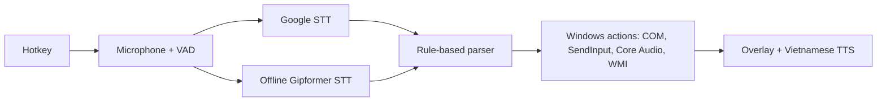

# VoicePilot

<p align="center">
  <a href="#tieng-viet"> <b>Tiếng Việt</b></a>
  &nbsp;&nbsp;|&nbsp;&nbsp;
  <a href="#english"> <b>English</b></a>
</p>

<a id="tieng-viet"></a>

##  Tiếng Việt

Trợ lý giọng nói tiếng Việt cho Windows. Nhấn phím tắt, nói lệnh bằng tiếng Việt, VoicePilot sẽ
điều khiển PowerPoint, Word, Excel, Edge/Chrome và Windows, hoặc gõ giúp bạn những gì bạn đọc vào
vị trí con trỏ. Chạy được trên laptop thường, không cần GPU, và dùng được hoàn toàn offline.

**[⬇ Tải bản mới nhất](https://github.com/namnguyen0503/VoicePilot/releases/latest)**:
giải nén rồi chạy `VoicePilot.exe`. Không cần cài đặt, không cần Python.

### Tính năng

| Nhóm | Ví dụ câu nói |
|---|---|
| PowerPoint | "lưu lại", "lưu thành báo cáo tháng chín", "slide tiếp theo", "slide trước", "slide đầu tiên", "slide cuối cùng", "bắt đầu trình chiếu", "dừng trình chiếu", "tạo bài trình chiếu mới" |
| Word / Excel | "tạo tài liệu word mới", "tạo bảng tính excel mới" |
| Trình duyệt (Edge, Chrome) | "mở youtube", "tìm thời tiết hôm nay", "giá vàng hôm nay bao nhiêu", "tab mới", "tab tiếp theo", "đóng tab", "cửa sổ mới", "cửa sổ ẩn danh" |
| Windows | "mở notepad", "chụp màn hình", "đóng cửa sổ", "tăng âm lượng 30%", "giảm độ sáng", "tắt tiếng", "bật tiếng", "bật tiết kiệm pin" |
| Nhạc | "phát nhạc", "tạm dừng nhạc", "bài tiếp theo", "bài trước" |
| Đọc chính tả | Chuyển sang chế độ đọc chính tả rồi nói; chữ được gõ vào ứng dụng đang dùng (có dấu tiếng Việt và emoji) |

- **Nói hoặc gõ:** nói lệnh, hoặc gõ đúng câu đó ở tab Text trên thanh nổi.
- **Lệnh tùy chỉnh:** tự tạo câu lệnh có tham số (ví dụ `hỏi google về {topic}`) gắn với một hành
  động hoặc phím tắt bất kỳ. Nhập/xuất dưới dạng JSON.
- **Sửa lệnh có sẵn:** đổi cách gọi từng lệnh và mức tăng/giảm âm lượng, độ sáng mặc định (20%).
- **Khởi động cùng Windows** (mặc định bật, tắt được trong Cài đặt).
- **Tìm cài đặt** (Ctrl+F) và hướng dẫn sử dụng ngay trong app.

Danh sách đầy đủ các lệnh: [`docs/COMMANDS.vi.md`](docs/COMMANDS.vi.md).

### Cách dùng

| Thao tác | Phím tắt mặc định |
|---|---|
| Bắt đầu nghe | `Ctrl + Alt + V` |
| Chuyển chế độ ra lệnh / đọc chính tả | `Ctrl + Alt + M` |

Một thanh nổi nhỏ hiện câu vừa nghe và kết quả. Thanh này không bao giờ lấy focus khỏi ứng dụng bạn
đang dùng. Phím tắt, bộ nhận dạng giọng nói và các tùy chọn khác nằm trong **Cài đặt** (biểu tượng
ở khay hệ thống).

**Yêu cầu:** Windows 10 x64 (đã kiểm thử; chưa kiểm trên Windows 11), có micro. Các lệnh Office cần
Microsoft Office bản desktop.

### Cách hoạt động

- **Nhận dạng giọng nói kết hợp:** dùng Google trước, khi lỗi hoặc mất mạng thì chuyển sang mô hình
  offline Gipformer 1.5 (INT8, chạy CPU). Chế độ offline giữ âm thanh trên máy.
- **Dễ đoán:** lệnh được khớp bằng luật, không dùng mô hình ngôn ngữ. Mỗi câu nói chạy tối đa một
  lệnh, và cửa sổ đích được kiểm lại trước khi thực hiện.
- **Công nghệ:** Python 3.12, PySide6, sherpa-onnx (ASR, Piper TTS, Silero VAD), pywin32, PyInstaller.

### Quyền riêng tư

Log chỉ chứa thời gian xử lý, trạng thái và mã lỗi, không bao giờ chứa nội dung bạn nói. Các câu
nói gần đây chỉ nằm trong bộ nhớ. Chế độ Google gửi âm thanh tới dịch vụ nhận dạng của Google; chế
độ offline không cần mạng.

### Build từ mã nguồn và giấy phép

Xem các lệnh build ở [phần tiếng Anh](#build-from-source). Giấy phép GPL-3.0-or-later (bắt buộc do
dùng espeak-ng để đọc văn bản). Xem [`LICENSE`](LICENSE) và
[`THIRD_PARTY_NOTICES.md`](THIRD_PARTY_NOTICES.md).

---

<a id="english"></a>

##  English

A Vietnamese voice assistant for Windows. Press a hotkey, say a command in Vietnamese, and
VoicePilot controls PowerPoint, Word, Excel, Edge/Chrome and Windows itself, or types what you
dictate at the cursor. It runs on an ordinary laptop with no GPU and also works fully offline.

**[⬇ Download the latest release](https://github.com/namnguyen0503/VoicePilot/releases/latest)**:
unzip and run `VoicePilot.exe`. No installation or Python needed.

### Features

| Area | What you can say (examples) |
|---|---|
| PowerPoint | "lưu lại", "lưu thành báo cáo tháng chín", "slide tiếp theo", "slide trước", "slide đầu tiên", "slide cuối cùng", "bắt đầu trình chiếu", "dừng trình chiếu", "tạo bài trình chiếu mới" |
| Word / Excel | "tạo tài liệu word mới", "tạo bảng tính excel mới" |
| Browser (Edge, Chrome) | "mở youtube", "tìm thời tiết hôm nay", "giá vàng hôm nay bao nhiêu", "tab mới", "tab tiếp theo", "đóng tab", "cửa sổ mới", "cửa sổ ẩn danh" |
| Windows | "mở notepad", "chụp màn hình", "đóng cửa sổ", "tăng âm lượng 30%", "giảm độ sáng", "tắt tiếng", "bật tiếng", "bật tiết kiệm pin" |
| Media | "phát nhạc", "tạm dừng nhạc", "bài tiếp theo", "bài trước" |
| Dictation | Switch to dictation mode and speak; the text is typed into the active app (Vietnamese and emoji) |

- **Voice or text input:** speak, or type the same commands in the Text tab.
- **Custom commands:** create your own phrases with parameters (for example `hỏi google về {topic}`)
  that map to any action or keyboard shortcut. Import and export them as JSON.
- **Editable built-in commands:** change how each built-in command is phrased, and set the default
  volume/brightness step (20%).
- **Starts with Windows** by default (can be turned off in Settings).
- **Searchable settings** (Ctrl+F) and an in-app user manual.

The full command list (in Vietnamese) is in [`docs/COMMANDS.vi.md`](docs/COMMANDS.vi.md).

### How to use

| Action | Default hotkey |
|---|---|
| Start listening | `Ctrl + Alt + V` |
| Switch command / dictation mode | `Ctrl + Alt + M` |

A small overlay shows what was heard and what happened. It never takes focus from the app you are
working in. Hotkeys, the speech engine and other options are in **Settings** (tray icon).

**Requirements:** Windows 10 x64 (tested; Windows 11 not yet verified), a microphone. Microsoft Office desktop is needed for the
Office commands.

### How it works



- **Hybrid speech recognition:** Google first, with the offline Gipformer 1.5 model (INT8, CPU) as
  fallback. Offline mode keeps audio on the machine.
- **Predictable:** commands are matched by rules, not by a language model. One utterance runs at
  most one command, and the target window is checked again before acting.
- **Stack:** Python 3.12, PySide6, sherpa-onnx (ASR, Piper TTS, Silero VAD), pywin32, PyInstaller.

### Privacy

Logs contain only timings, statuses and error codes, never what you said. Recent transcripts stay
in memory. Google mode sends audio to Google's speech service; offline mode needs no network.

### Build from source

```powershell
py -3.12 -m venv .venv
.\.venv\Scripts\python.exe -m pip install -r requirements.lock -e ".[dev]"
.\.venv\Scripts\python.exe tools\download_models.py      # speech models into models\
.\.venv\Scripts\python.exe -m voicepilot                # run the app
$env:QT_QPA_PLATFORM = "offscreen"; .\.venv\Scripts\python.exe -m pytest -q
powershell -ExecutionPolicy Bypass -File tools\build.ps1 # portable ZIP in dist\
```

### License

GPL-3.0-or-later (required by espeak-ng, used for text to speech). See [`LICENSE`](LICENSE) and
[`THIRD_PARTY_NOTICES.md`](THIRD_PARTY_NOTICES.md) for third-party components and model sources.
