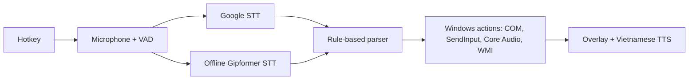

# VoicePilot

A Vietnamese voice assistant for Windows. Press a hotkey, say a command in Vietnamese, and
VoicePilot controls PowerPoint, Word, Excel, Edge/Chrome and Windows itself, or types what you
dictate at the cursor. It runs on an ordinary laptop with no GPU and also works fully offline.

**[⬇ Download the latest release](https://github.com/namnguyen0503/VoicePilot/releases/latest)**:
unzip and run `VoicePilot.exe`. No installation or Python needed.

## Features

| Area | What you can say (examples) |
|---|---|
| PowerPoint | "lưu lại", "lưu thành báo cáo tháng chín", "slide tiếp theo", "slide trước", "slide đầu tiên", "slide cuối cùng", "bắt đầu trình chiếu", "dừng trình chiếu", "tạo bài trình chiếu mới" |
| Word / Excel | "tạo tài liệu word mới", "tạo bảng tính excel mới" |
| Browser (Edge, Chrome) | "mở youtube", "tìm thời tiết hôm nay", "giá vàng hôm nay bao nhiêu", "tab mới", "tab tiếp theo", "đóng tab", "cửa sổ mới", "cửa sổ ẩn danh" |
| Windows | "mở notepad", "chụp màn hình", "đóng cửa sổ", "tăng âm lượng 30%", "giảm độ sáng", "tắt tiếng", "bật tiếng", "bật tiết kiệm pin" |
| Media | "phát nhạc", "tạm dừng nhạc", "bài tiếp theo", "bài trước" |
| Dictation | Switch to dictation mode and speak; the text is typed into the active app (Vietnamese and emoji) |

- **Voice or text input:** speak, or type the same commands in the Text tab.
- **Custom commands:** create your own phrases with parameters (for example `hỏi google về {topic}`)
  that map to any action or keyboard shortcut. Import and export them as JSON.
- **Editable built-in commands:** change how each built-in command is phrased, and set the default
  volume/brightness step (20%).
- **Searchable settings** (Ctrl+F) and an in-app user manual.

The full command list (in Vietnamese) is in [`docs/COMMANDS.vi.md`](docs/COMMANDS.vi.md).

## How to use

| Action | Default hotkey |
|---|---|
| Start listening | `Ctrl + Alt + Space` |
| Switch command / dictation mode | `Ctrl + Alt + D` |

A small overlay shows what was heard and what happened. It never takes focus from the app you are
working in. Hotkeys, the speech engine and other options are in **Settings** (tray icon).

**Requirements:** Windows 10 or 11 (x64), a microphone. Microsoft Office desktop is needed for the
Office commands.

## How it works



- **Hybrid speech recognition:** Google first, with the offline Gipformer 1.5 model (INT8, CPU) as
  fallback. Offline mode keeps audio on the machine.
- **Predictable:** commands are matched by rules, not by a language model. One utterance runs at
  most one command, and the target window is checked again before acting.
- **Stack:** Python 3.12, PySide6, sherpa-onnx (ASR, Piper TTS, Silero VAD), pywin32, PyInstaller.

## Privacy

Logs contain only timings, statuses and error codes, never what you said. Recent transcripts stay
in memory. Google mode sends audio to Google's speech service; offline mode needs no network.

## Build from source

```powershell
py -3.12 -m venv .venv
.\.venv\Scripts\python.exe -m pip install -r requirements.lock -e ".[dev]"
.\.venv\Scripts\python.exe tools\download_models.py      # speech models into models\
.\.venv\Scripts\python.exe -m voicepilot                # run the app
$env:QT_QPA_PLATFORM = "offscreen"; .\.venv\Scripts\python.exe -m pytest -q
powershell -ExecutionPolicy Bypass -File tools\build.ps1 # portable ZIP in dist\
```

## License

GPL-3.0-or-later (required by espeak-ng, used for text to speech). See [`LICENSE`](LICENSE) and
[`THIRD_PARTY_NOTICES.md`](THIRD_PARTY_NOTICES.md) for third-party components and model sources.
